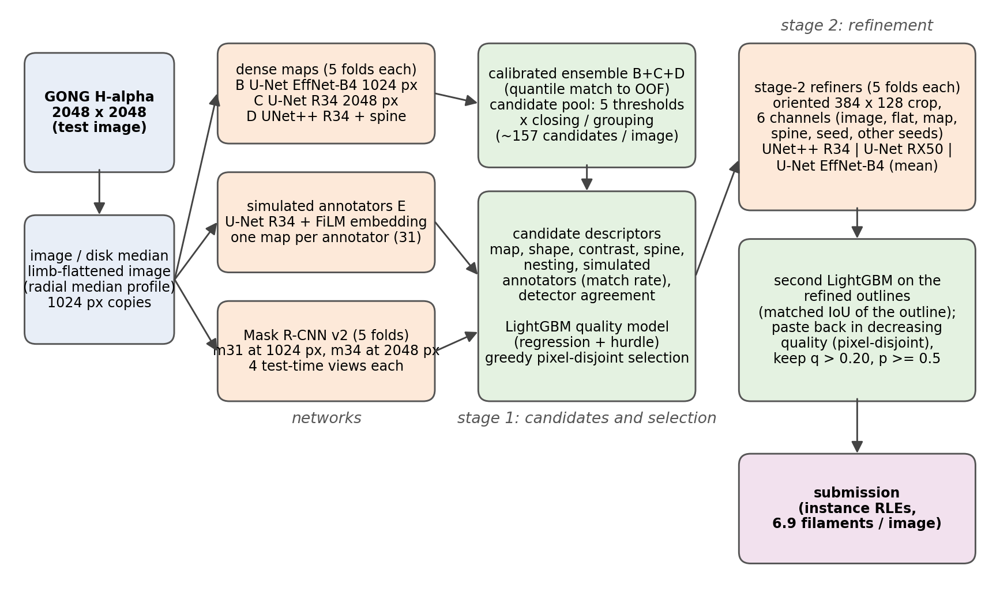

# Solar filament instance segmentation — Solar Filament Segmentation Challenge 2026

Solution of team **Hibiki8739** to the [Solar Filament Segmentation Challenge 2026](https://www.kaggle.com/competitions/filament-segmentation-2026)
(GONG H-alpha full-disk images, MAGFiLO annotations, panoptic quality metric).

| | Out of fold (707 training images, 5 folds) | Public leaderboard |
|---|---|---|
| Final submission | PQ **0.4619** (95 % bootstrap interval [0.453, 0.471]) | 0.40 |

The final submission is exactly the output of [`pipeline.ipynb`](pipeline.ipynb): it loads the trained weights stored in
[`weights/`](weights) and turns the 180 test images into the submission file, without retraining anything.

## Method in one paragraph

Three dense networks (U-Net EfficientNet-B4, U-Net ResNet34 at the native 2048 px, UNet++ ResNet34 with a spine
head) predict the soft annotator-mean filament mask. Their calibrated mean is cut into about 157 candidate regions
per image (5 thresholds x gap closing / fragment grouping). Every candidate is described by map, shape and contrast
statistics, by how many of 31 *simulated annotators* (an annotator-conditioned U-Net) would draw a matching outline,
and by its agreement with two Mask R-CNN detectors (1024 px and native 2048 px, 4 test-time views each). A LightGBM
quality model predicts the expected matched IoU of every candidate, and a greedy pixel-disjoint selection keeps the
best ones. Three stage-2 refiner networks redraw every selected instance in an oriented crop; a second LightGBM
re-scores the refined outlines and decides which instances are kept (6.9 per test image). Details, ablations and evaluation: the technical
report (LaTeX source in [`report/`](report), figures in `report/figures/`).



## Repository

```
pipeline.ipynb        end-to-end inference with the stored weights + figures + evaluation (run on Kaggle, outputs kept)
solfil/               inference package (used by the notebook)
  preprocess.py       reading, disk-median normalisation, limb-darkening removal, quantile calibration
  nets.py             network definitions and test-time prediction (dense members, simulated annotators, detectors, refiners)
  candidates.py       candidate pool and candidate descriptors, greedy selection
  refine.py           oriented crops, paste-back, descriptors of the refined outlines
  pipeline.py         the whole inference: python -m solfil.pipeline --images <test images> --weights weights --out submission.csv
  viz.py              figures
weights/              all trained weights (float16, 5 fold models per network, 45 files, about 2.5 GB),
                      the two LightGBM quality models (stage1/, stage2/) and the calibration histograms
training/             the training code of every stage (sources of the Kaggle notebooks that produced the weights)
results/              final submission, out-of-fold evaluation (eval_oof.json, per-annotation / per-prediction / per-record
                      tables) and the out-of-fold final instances (oof_final.pkl)
tools/run_stage.py    runs a training stage outside Kaggle
tools/export_weights_kaggle.py   how weights/ was collected from the Kaggle training notebooks
report/               technical report (LaTeX source, figures)
requirements.txt
```

## Reproducing the submission

```bash
pip install -r requirements.txt
python -m solfil.pipeline --images <competition data>/test/test_images --weights weights --cache /tmp/solfil --out submission.csv
```

or run `pipeline.ipynb`. With two GPUs the networks run in two worker processes (about 2.1 h on Kaggle's
2 x T4); a single GPU or the CPU also works (slower). The run on Kaggle that produced the final submission is the
Kaggle notebook [`filament-solfil-inference`](https://www.kaggle.com/code/hibiki8739/filament-solfil-inference); its output `submission.csv` is the selected
final submission.

## Reproducing the training

The weights were trained on Kaggle (2 x T4 GPUs) by the notebooks in `training/`, in this order. Every stage reads the
outputs of earlier stages from `/kaggle/input/...`; `tools/run_stage.py` replaces the Kaggle paths to run a stage
elsewhere. Folds are fixed for all stages: `np.random.RandomState(42).permutation` of the sorted training image names,
image `k` of the permutation in fold `k % 5`.

| stage | file | produces | GPU time |
|---|---|---|---|
| 01 | `training/s01_dense_a.py` | dense member A (U-Net ResNet34, 1024 px crops of the 2048 px frames); used only to seed the refiner training (stage 06) | 4.3 h |
| 02 | `training/s02_dense_b.py` | dense member B (U-Net EfficientNet-B4, 1024 px): `dense_b_effb4` | 5.0 h |
| 03 | `training/s03_dense_c.py` | dense member C (U-Net ResNet34, image + limb-flattened image, 2048 px): `dense_c_r34_2048` | 4.8 h |
| 04 | `training/s04_dense_d.py` | dense member D (UNet++ ResNet34, mask + spine): `dense_d_unetpp_spine` | 3.8 h |
| 05 | `training/s05_sim_annotators.py` | simulated annotators E (annotator-conditioned U-Net): `sim_annotators` | 3.3 h |
| 06 | `training/s06_select_ab.py` | first-generation selection on A+B (seeds for the refiner training) | CPU 49 min |
| 07 | `training/s07_select_bcd.py` | first-generation selection on B+C+D (seeds for the refiner training) | CPU 66 min |
| 08 | `training/s08_select_bcd_low.py` | the same selection down to a low threshold (seeds for refiner 3) | CPU 21 min |
| 09 | `training/s09_refiner_unetpp_r34.py` | stage-2 refiner 1 (UNet++ ResNet34): `refiner_unetpp_r34` | 4.0 h |
| 10 | `training/s10_refiner_unet_resnext50.py` | stage-2 refiner 2 (U-Net ResNeXt50): `refiner_unet_resnext50` | 2.6 h |
| 11 | `training/s11_refiner_unet_effb4.py` | stage-2 refiner 3 (U-Net EfficientNet-B4): `refiner_unet_effb4` | 3.3 h |
| 12 | `training/s12_detector_1024.py` | Mask R-CNN v2 at 1024 px (m31): `detector_1024` | 5.0 h |
| 13 | `training/s13_detector_2048.py` | Mask R-CNN v2 at native 2048 px (m34): `detector_2048` | 5.6 h |
| 14 | `training/s14_pool_quality.py` | candidate pool, descriptors, first LightGBM quality model, selection: `stage1/` | CPU 1.0 h |
| 15 | `training/s15_refine.py` | the three refiners applied to the stage-14 selection (out of fold and test) | 0.3 h |
| 16 | `training/s16_rescore_submit.py` | second LightGBM on the refined outlines, final selection, OOF evaluation: `stage2/` | CPU 15 min |

## Rules

Only the competition data are used (no external annotations, no external images); inference uses the provided test
images only and no file-name metadata (time, site). All predictions are pixel-disjoint.

## License

Code: MIT. The weights were trained on the MAGFiLO data of the competition and are provided for reproducing the result.
